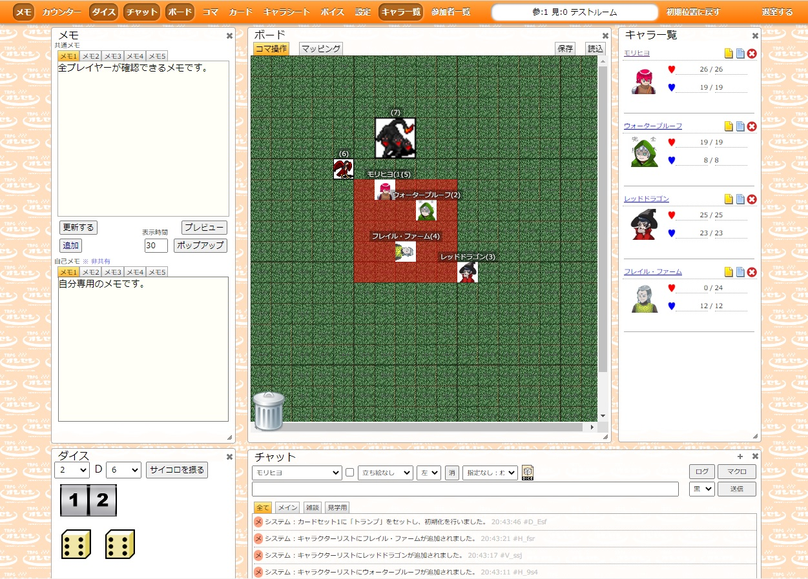

# オンセンルーム (OnsenRoom)

ブラウザだけで遊べる、TRPG オンラインセッション用のチャットツールです。
インストール不要・アカウント不要で、PC・スマホ両対応です。

---

## まず試してみる

公式鯖で、インストール不要・すぐにプレイできます。

- 公式鯖: **[https://trpgonsenroom.com/](https://trpgonsenroom.com/)**
- 親サービス (TRPG オンセン SNS、キャラクターシート・シナリオ共有などが使えます): [https://trpgsession.com/](https://trpgsession.com/)

---

## 主な機能

### 遊ぶ機能

- チャット (発言者設定・立ち絵・色分け・マクロ・タグ)
- ダイスボット (オンセンダイスボット、[BCDice](https://bcdice.org/) 連携)
- キャラクターシート (HP/MP・詳細・立ち絵・マクロ)
- コマ、カード、共有メモ (画像共有可)
- マッピング (マップチップ・レイヤー)
- BGM 再生
- GM サポート機能 (シナリオセット・ランダム判定)
- カウンター機能
- ボードデータの保存/読込 (XML 形式)
- スマホ対応 (PC 版とは別の UI)

### 親サービス (TRPG オンセン SNS) との連携

- キャラクターデータの呼び出し
- シナリオセットの呼び出し
- リプレイのアップロード

---

## 自前のサーバに設置する

公式鯖以外にも、自分で Web サーバを用意して設置することができます。

### 動作要件

- **PHP**: 8.0 以上を推奨 (7.4 以降で動作確認済み)
    - 推奨: PHP 8.3 (本バージョンで検証済み)
- **Web サーバ**: Apache / nginx など、PHP が動作する任意の HTTP サーバ
- **ブラウザ側**: モダンブラウザ (Chrome, Firefox, Safari, Edge の最新版)
    - JavaScript はブラウザ標準 API のみ使用 (外部ライブラリ依存なし)

### クイックスタート

1. 本リポジトリをダウンロード (または `git clone`) し、Web サーバの公開ディレクトリに配置
2. `s/common/const.php` を編集し、以下を自サイト用に設定
    - `SITE_TITLE`, `SITE_DESCRIPTION` (任意)
    - `ADMINISTRATOR_PASSWORD` (管理者ページ用、必ず変更)
    - `AUTHENTICATION_CODE` (親サービスとの連携認証コード、必ず変更)
    - `CPU_CORE` (サーバの CPU コア数)
3. 書き込み可能なディレクトリ (`r/`, `log/`) に Web サーバ (nginx/apache ユーザ) の書き込み権限を付与
4. ブラウザで設置先 URL にアクセスし、ルーム作成を試す

> 詳細な手順は [公式ドキュメント](https://trpgsession.com/onsenroom.php) も参照ください。

---

## ライセンス

[MIT License](https://github.com/ponta0321/OnsenRoom/blob/master/LICENSE)

本ソフトウェアは MIT ライセンスのもとで公開しています。
商用・非商用を問わず、自由にご利用・改変・再配布いただけます。

---

## 変更履歴

- [CHANGELOG](https://github.com/ponta0321/OnsenRoom/blob/master/CHANGELOG.md)

---

## バグ報告・要望・開発参加

バグ報告・機能要望・ドキュメント改善・Pull Request などの開発寄与を歓迎します。

- GitHub の [Issue](https://github.com/ponta0321/OnsenRoom/issues) / [Pull Request](https://github.com/ponta0321/OnsenRoom/pulls)
- 親サービス [TRPG オンセン SNS の要望・不具合トピック](https://trpgsession.com/topic-list.php)
- E メール: trpg_session@yahoo.co.jp
- [Twitter / @ponta_banto](https://twitter.com/ponta_banto)

---

## 開発情報

- 開発言語: PHP + JavaScript (vanilla、外部ライブラリ依存なし)
- 開発者: ぽん太＠番頭 ([@ponta0321](https://github.com/ponta0321))
